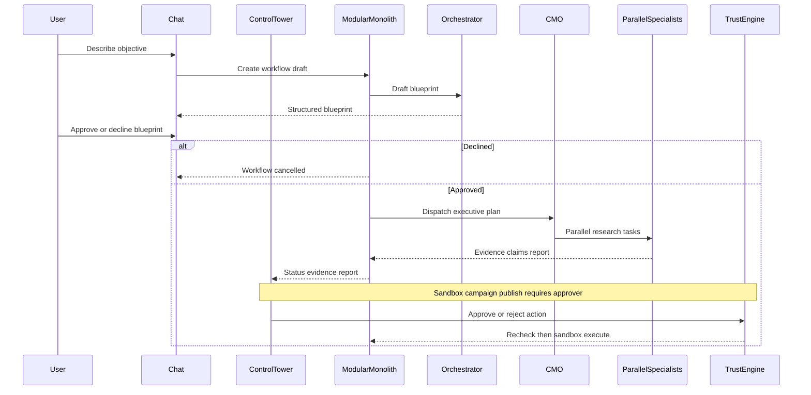

---
todos:
  - id: l9-000-seed
    status: in_progress
    content: Seed build kit into luxor9 repo; ADRs for dual UI + RE-pack-on-generic-engine; save this plan under docs/plans/
  - id: l9-001-scaffold
    content: 'Scaffold apps/api + apps/control-tower, Compose Postgres, quality gates, health smoke tests'
    status: pending
  - id: l9-002-db
    content: 'Alembic models/contracts: tenancy, workflow/blueprint, agents, evidence, approvals, audit, metering'
    status: pending
  - id: l9-003-clerk-rbac
    content: 'Clerk Hobby auth, tenant isolation, admin/member/approver'
    status: pending
  - id: l9-004-trust
    content: Trust Engine + approval binding + sandbox campaign publish + audit tests
    status: pending
  - id: l9-005-chat-blueprint
    content: Chat UI/API + blueprint approve/decline gate
    status: pending
  - id: l9-006-tower
    content: 'Control Tower overview, workflow, approvals, evidence on real APIs'
    status: pending
  - id: l9-007-graph
    content: LangGraph Orchestrator→CMO→parallel specialists with Postgres checkpoints
    status: pending
  - id: l9-008-cmo-pack
    content: RE CMO market/competitor/launch pack with evidence evaluation
    status: pending
  - id: l9-009-pilot
    content: 'Metering hooks, security checklist, paid pilot demo packaging'
    status: pending
name: LUXOR9 Phase 0 Plan
overview: 'Greenfield LUXOR9 platform in the empty `luxor9` repo: RE-branded SaaS with a generic chat→blueprint→hierarchical agents engine, Control Tower governance, Clerk auth, and a Dubai real-estate CMO pack as the first workflow.'
isProject: false
---
# LUXOR9 Phase 0 — Discovery Plan (Approved Product Baseline)

## Locked decisions (from interview)

| Decision | Choice |
|---|---|
| Code home | Greenfield in [`/agent/repos/luxor9`](/agent/repos/luxor9) (currently empty aside from README/assets). Treat `luxor9-unified-os`, `luxor9-core`, `Ceo-brain` as **read-only inventory** — port later only behind clean module boundaries. |
| Product shape | **C**: sell “Luxor9 for Real-Estate Developers”; build **generic** blueprint→hierarchy→workflow engine underneath. |
| UX | **Both**: ChatGPT-style chat to create/steer; Control Tower to monitor, approve, audit. |
| Auth | **Clerk Hobby** now; upgrade to Pro+MFA before first external pilot that can approve consequential actions. |
| Human RBAC (MVP) | `admin` / `member` / `approver` only. PRD job titles are display labels later. |
| Agent hierarchy | 3 levels: **Orchestrator → CMO executive → parallel specialists** (market, competitor, strategy, evaluator). Future executives = new packs, not day-one microservices. |
| Evidence | Public web receipts primary; uploads allowed; model-only gaps marked `UNVERIFIED`. |
| Consequential action | Research + report real; **campaign publish** is the Trust Engine action type but executes only via **sandbox adapter**. |
| Monetization later | Emit `workflow_run` metering events now; no Stripe in foundation tickets. |
| Out of MVP | Full C-suite, Deep Agents dynamic spawn, HERMES as authority, CopilotKit/AG-UI, real ad/CRM side effects, paid Dubai data APIs. |

## Target loop (what we are building)



## Smallest coherent architecture

**Modular monolith** (ADR-0001 already in build kit): one FastAPI app with domain modules; Next.js Control Tower + chat UI; PostgreSQL system of record; LangGraph for durable workflow + parallel specialist nodes; Redis only when a worker queue is proven necessary (not in L9-001).

Proposed repo layout (seed from build kit, then implement):

```text
apps/
  control-tower/     # Next.js + Clerk: chat + tower routes
  api/               # FastAPI modular monolith
governance/          # trust_engine, approvals, audit, policies
intelligence/        # graph, planner, evaluation, routing
executives/
  base/
  cmo/               # first pack: market/competitor/launch
runtime/adapters/    # stubs: hermes, model, research, sandbox_publish
shared/contracts/
infrastructure/      # docker compose postgres, alembic
docs/                # PRD, blueprint, roadmap, adr, plans/
tests/
```

**Authority boundaries**
- Clerk authenticates humans; server resolves tenant + role.
- Trust Engine authorizes; model text never authorizes.
- LangGraph owns workflow state; agents propose actions only.
- HERMES / Deep Agents / CopilotKit = adapter stubs until a spike proves value.

## Stack baseline (verify at install time; pin in lockfiles)

- Python 3.12, FastAPI, Pydantic v2, SQLAlchemy 2 + Alembic, PostgreSQL
- LangGraph + `langgraph-checkpoint-postgres`
- Next.js + TypeScript + Tailwind + shadcn/ui + Clerk
- Pytest + Playwright later; Docker Compose for Postgres locally
- OpenTelemetry hooks from foundation forward

Compatibility note: Alembic 1.20+ requires SQLAlchemy 2.0+ / Python 3.10+; LangGraph supports Python ≥3.10. Re-check current docs when pinning in L9-001.

## Phased tickets (execution order)

After this plan is approved and saved under `docs/plans/`:

1. **L9-000 kit seed** — Copy build-kit docs/rules/prompts/AGENTS.md into `luxor9`; commit baseline; ADR for chat+Tower dual surface and RE-pack-on-generic-engine.
2. **L9-001 scaffold** — `apps/api` health + smoke test; `apps/control-tower` shell; lint/format/type/test scripts; `.env.example`; Compose Postgres only.
3. **L9-002 database/contracts** — tenants, users/memberships, roles, workflows, blueprints, agents, evidence, claims, approvals, audit, metering event tables + Alembic.
4. **L9-003 Clerk + tenancy + RBAC** — `/me`, tenant isolation tests, admin/member/approver.
5. **L9-004 Trust + approvals + audit** — ALLOW/DENY/REQUIRES_APPROVAL; exact-action binding; expiry/replay/tamper tests; sandbox publish adapter.
6. **L9-005 Chat + blueprint gate** — chat API + UI; blueprint schema; customer approve/decline pauses graph.
7. **L9-006 Control Tower foundation** — overview, workflow detail, approval centre, evidence/report views on real data.
8. **L9-007 LangGraph hierarchy** — Orchestrator → CMO → parallel specialists; checkpoint survive restart.
9. **L9-008 CMO pack** — market/competitor/launch; evidence normalization; UNVERIFIED flags; evaluation corpus.
10. **L9-009 pilot packaging** — metering events exposed; security review checklist; demo script for paid RE pilot seat.

## Risks and mitigations

- **Dual UI scope creep** — Chat and Tower share one workflow API; no second business logic path.
- **Generic engine boil-the-ocean** — Only RE CMO pack registers specialists in MVP; other packs are stubs in registry UI.
- **Evidence theater** — Require source URL/upload for material claims; fail eval if unsupported rate too high.
- **Clerk Hobby MFA gap** — Document upgrade gate before external consequential approvers.
- **Old monorepo temptation** — Inventory-only; any port needs ADR + tests in the new tree.

## Unresolved items (defaults applied)

- Object storage: local filesystem/DB blobs for MVP uploads; S3-compatible later.
- Redis/Celery: deferred until LangGraph worker process needs a separate queue.
- Model provider: single adapter interface; pick provider at L9-007 with env keys only.
- Billing: metering events only until pilot pricing exists.

## Single next ticket

**L9-000 / L9-001**: seed kit into [`luxor9`](/agent/repos/luxor9), write ADRs + this plan under `docs/plans/`, then scaffold API + Control Tower with health smoke tests — no auth, agents, or dashboards yet beyond shell.
